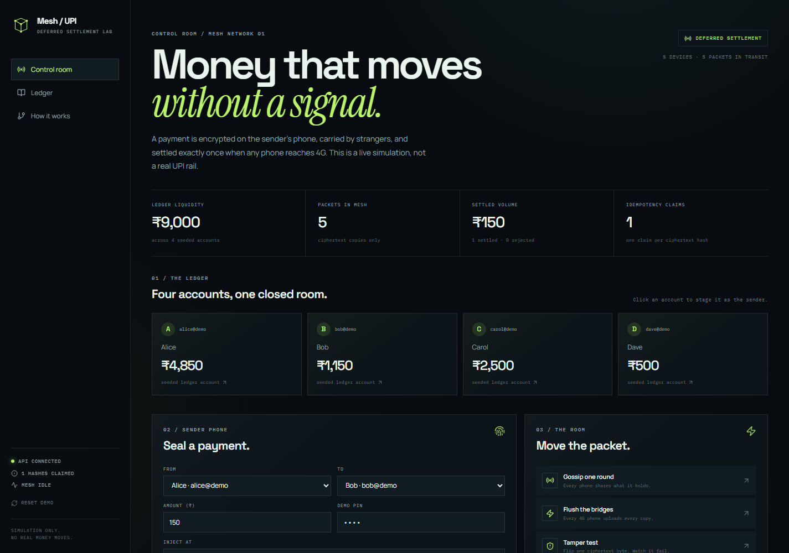
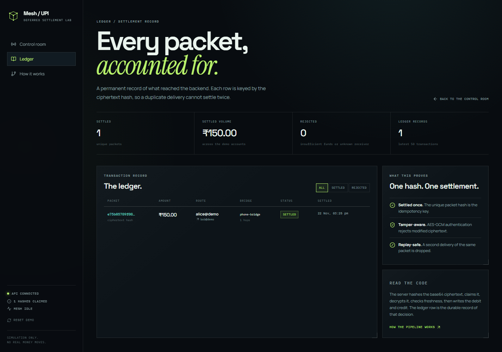

# MeshPay

> Offline payments, deferred settlement, one delivery.

[](https://meshpay.furqankhan.dev)
[](https://furqankhan.dev)
[](LICENSE)

MeshPay is a working simulation of deferred UPI settlement over a Bluetooth-style mesh. A sender encrypts a payment on a phone, nearby phones carry the ciphertext, and the first phone to reach a 4G bridge uploads it. The backend decrypts the instruction, checks freshness, and settles it once. This is a systems and cryptography demo, not a real UPI rail, and no real money moves.

Part of [Furqan Khan's portfolio](https://furqankhan.dev).

**Live:** https://meshpay.furqankhan.dev · **API health:** https://mesh-pay-api.onrender.com/api/health · **Source:** https://github.com/fk219/mesh-pay · **Case study:** https://furqankhan.dev

## What it is

The app is a MERN rebuild of an earlier Spring Boot demo:

- `web` is a React control room with a mesh map, event feed, payment form, failure labs, and ledger.
- `api` is an Express service with the hybrid encryption, mesh simulator, idempotent settlement logic, and MongoDB models.
- `java-reference` preserves the original Spring Boot and H2 implementation for comparison.

The public lab is a single simulated route: seal a packet, gossip it between virtual phones, flush a bridge, and watch the ledger settle or reject it.

## The signature idea

Three mechanisms carry the demo.

**Hybrid encryption.** Each payment instruction is encrypted with a fresh AES-256-GCM key. RSA-2048-OAEP wraps only that key. The wire format is:

```
RSA-encrypted AES key (256 bytes) + IV (12 bytes) + ciphertext + GCM tag (16 bytes)
```

The server decrypts the AES key with its RSA private key, then authenticates and decrypts the instruction. A single flipped ciphertext byte fails the GCM tag.

**Gossip routing.** Five virtual phones form the mesh: four offline relays and one 4G bridge. A gossip round copies packets to nearby phones and decrements the TTL at each hop. The bridge uploads its copies when flushed.

**Exactly-once settlement.** The SHA-256 hash of the base64 ciphertext is the idempotency key. An in-process claim set short-circuits obvious duplicates, and a unique MongoDB index on `packetHash` rejects concurrent duplicates. Four simultaneous uploads of one packet produce one debit and three duplicates.

## What works

- Hybrid AES-256-GCM and RSA-2048-OAEP encryption with a published server public key.
- Five-phone mesh simulation with TTL-based gossip and a 4G bridge.
- Idempotent ingestion backed by a SHA-256 ciphertext hash and a unique index.
- Duplicate storm test: four concurrent bridge-style uploads of one packet, one settlement.
- Tamper test: one flipped ciphertext byte is rejected before settlement.
- Replay test: the first delivery settles, the second is dropped as a duplicate.
- Insufficient-funds and unknown-receiver rejection paths.
- Seeded balances, a transaction ledger, and a reset that restores the demo.
- Request IDs in `x-request-id`, one structured JSON log line per request, and an OpenAPI 3.1 document at `/api/openapi.json`.
- Rate limits on the public lab and an operator token on destructive reset actions.

## Screenshots

| Control room | Ledger |
|---|---|
|  |  |

## Tech stack in detail

| Layer | Technology | What it does here |
|---|---|---|
| Control room | React 18, Vite 5, React Router 6, Lucide | Payment form, mesh map, event feed, ledger, explainer |
| API | Node.js, Express 4 | REST service under `/api`, error handling, CORS |
| Cryptography | Node `crypto` | AES-256-GCM payloads, RSA-2048 OAEP-SHA256 key wrapping, SHA-256 hashes |
| Data | MongoDB, Mongoose 8 | `Account` and `Transaction` models, unique packet hash |
| Validation | Zod 4 | Send and bridge payload schemas |
| Security | Helmet, `express-rate-limit`, operator token | Headers, request limits, reset gate |
| Observability | Custom request context | Request IDs and one JSON log entry per response |
| API contract | Hand-written OpenAPI 3.1 | Machine-readable contract served by the API |
| Tests | Vitest 2, Supertest, `mongodb-memory-server` | 9 API tests against an in-memory database |
| Deployment | Render, Vercel, Docker, GitHub Actions | API hosting, static frontend, container build, CI |

## Architecture

The browser never holds a private key. The API generates an RSA key pair when the process starts and exposes the public key at `/api/server-key`. The control room asks the API to seal a packet, then drives the simulated mesh. A bridge upload enters the same ingestion path used by `/api/bridge/ingest`.

```
React control room
        │  POST /api/demo/send
        ▼
Express API
        │  AES-256-GCM(instruction)
        │  RSA-OAEP(aes key)
        ▼
Mesh simulator: 5 phones, gossip with TTL
        │  POST /api/mesh/flush
        ▼
ingestPacket
        │  SHA-256(base64 ciphertext)
        ├── already claimed / unique index -> DUPLICATE_DROPPED
        ▼
decrypt -> check age -> settle in MongoDB -> SETTLED or REJECTED
```

Repository layout:

```
web/
  src/
    pages/          control room, ledger, how it works
    components/     mesh map, event feed
    api.js          API calls and retry handling
    useMesh.js      demo state and actions
api/
  src/
    app.js          Express app and middleware
    crypto.js       RSA-OAEP + AES-256-GCM
    mesh.js         virtual phone simulator
    ledger.js       idempotent ingestion and settlement
    routes.js       REST surface
    models.js       Account and Transaction schemas
    openapi.js      OpenAPI 3.1 contract
  test/flow.test.js
  Dockerfile
java-reference/     original Spring Boot + H2 implementation
docs/
render.yaml
```

## Run it locally

### Prerequisites

- Node.js 22 (the version in `.nvmrc`)
- MongoDB running locally, or a MongoDB Atlas URI
- Docker, only if you want to build the API image

### Install

```bash
npm run install:all
```

This installs dependencies in `api` and `web`.

### Environment

```bash
cp api/.env.example api/.env
cp web/.env.example web/.env
```

| Name | Required | Purpose |
|---|---|---|
| `MONGODB_URI` | Yes, or use the local default | MongoDB connection string. The config falls back to `mongodb://127.0.0.1:27017/meshpay`. |
| `PORT` | No | API port; defaults to `4100`. |
| `CORS_ORIGIN` | No | Comma-separated browser origins. An empty value allows any origin. |
| `PACKET_MAX_AGE_SECONDS` | No | Freshness window for a signed instruction; defaults to `86400`. |
| `ADMIN_TOKEN` | No | Operator token for reset endpoints. Set it to override the public demo default. |
| `IDEMPOTENCY_TTL_SECONDS` | No | Present in `.env.example`, but the current in-memory claim cache does not apply a TTL. |
| `VITE_API_URL` | No | API base URL. If unset, the web app uses same-origin `/api`. |
| `VITE_DEMO_ADMIN_TOKEN` | No | Token the UI sends on reset actions. This is a public demo gate, not a production secret. |

### Run

```bash
npm run dev:api
npm run dev:web
```

Run the two commands in separate terminals.

| App | URL |
|---|---|
| Control room | http://localhost:5175 |
| API | http://localhost:4100 |

The Vite dev server proxies `/api` to port 4100. The API seeds the four demo accounts on startup if the account collection is empty.

### Demo accounts

| VPA | Holder | Seeded balance |
|---|---|---|
| `alice@demo` | Alice | ₹5,000 |
| `bob@demo` | Bob | ₹1,000 |
| `carol@demo` | Carol | ₹2,500 |
| `dave@demo` | Dave | ₹500 |

The demo PIN is any 4 or more digits. It is hashed into the instruction but is not checked against a real bank.

## API

All routes are under `/api`. Destructive reset routes require the `x-demo-admin-token` header. Rate limits are 120 requests per minute across `/api`, 30 per minute on `/api/demo/send`, `/api/mesh/flush`, and `/api/bridge/ingest`, and 15 per minute on reset writes.

| Method | Path | Purpose |
|---|---|---|
| `GET` | `/api/health` | Health check with MongoDB readiness, uptime, and timestamp. |
| `GET` | `/api/openapi.json` | OpenAPI 3.1 contract for the API. |
| `GET` | `/api/server-key` | RSA public key and scheme metadata. |
| `GET` | `/api/accounts` | Seeded account balances. |
| `GET` | `/api/transactions` | Latest ledger rows, newest first. |
| `POST` | `/api/demo/send` | Encrypt a payment instruction and inject it into the mesh. |
| `POST` | `/api/demo/tamper` | Flip a ciphertext byte and ingest the result. |
| `POST` | `/api/demo/replay` | Ingest the same packet twice and return both outcomes. |
| `POST` | `/api/demo/duplicate-storm` | Ingest one packet four times concurrently. |
| `POST` | `/api/demo/reset` | Restore balances, clear the ledger, and reset the mesh. |
| `GET` | `/api/mesh/state` | Device packet counts and the claim cache size. |
| `POST` | `/api/mesh/gossip` | Run one gossip round. |
| `POST` | `/api/mesh/flush` | Upload every packet held by an online bridge. |
| `POST` | `/api/mesh/reset` | Clear the mesh without touching the ledger. |
| `POST` | `/api/bridge/ingest` | Production-shaped bridge ingestion endpoint. |

The bridge endpoint accepts `x-bridge-node-id` and `x-hop-count` headers, which are stored with the settled transaction. Request IDs are returned in `x-request-id`.

## Tests

```bash
npm test
```

The root script runs the API suite: 9 Vitest tests in `api/test/flow.test.js`, using Supertest and an in-memory MongoDB. The tests cover health and database readiness, seeded accounts, gossip and flush settlement, duplicate storms, replay, tamper rejection, insufficient funds, operator-token gating, payload validation, and reset.

The CI workflow runs the same tests and the frontend production build on every push and pull request.

## Deployment

- **Frontend:** Vercel static deployment. `web/vercel.json` rewrites `/api/:path*` to `https://mesh-pay-api.onrender.com/api/:path*` and sends other paths to `index.html`.
- **API:** Render web service from `api/`, using `npm install` and `npm start`, with `/api/health` as the health check. `render.yaml` sets Node 22 and a 24-hour packet age.
- **Database:** MongoDB Atlas, database `meshpay`.
- **Container:** `api/Dockerfile` builds a Node 20 Alpine image, exposes port 4100, and runs `node src/index.js`.
- **CI:** GitHub Actions runs the API tests and the frontend build.

## Limits and notes

- **Offline double-spend is possible until settlement.** The receiver cannot verify that the sender has funds while offline, so the payment is an IOU. A malicious sender can try to spend the same balance twice; whichever packet reaches the backend first settles, and the other is rejected if funds are gone.
- Idempotency is per ciphertext. Re-encrypting the same economic instruction produces a different hash and is treated as a new packet.
- The mesh is simulated in software. Real background BLE behavior, discovery, and battery constraints are much harder.
- The RSA private key is generated per process and is lost on restart. A production system needs an HSM or KMS.
- The claim cache is in memory and resets with the process. The MongoDB unique index still protects persisted transactions across restarts.
- The demo PIN is hashed but never verified against a bank or UPI PIN authority.
- This is not connected to NPCI, a bank core, or a real payment rail.
- The Render free plan can cold-start after inactivity.

The cryptography and idempotency code are production-shaped; the surrounding infrastructure is deliberately demo-sized.

## Credits and my contribution

- Original Spring Boot demo: `perryvegehan`, preserved in `java-reference/` for comparison.
- The MERN rebuild, hybrid encryption, mesh simulator, idempotent ledger, React control room, tests, Dockerfile, and deployment are the work presented in this repository.

## License

MIT. See [LICENSE](LICENSE).
